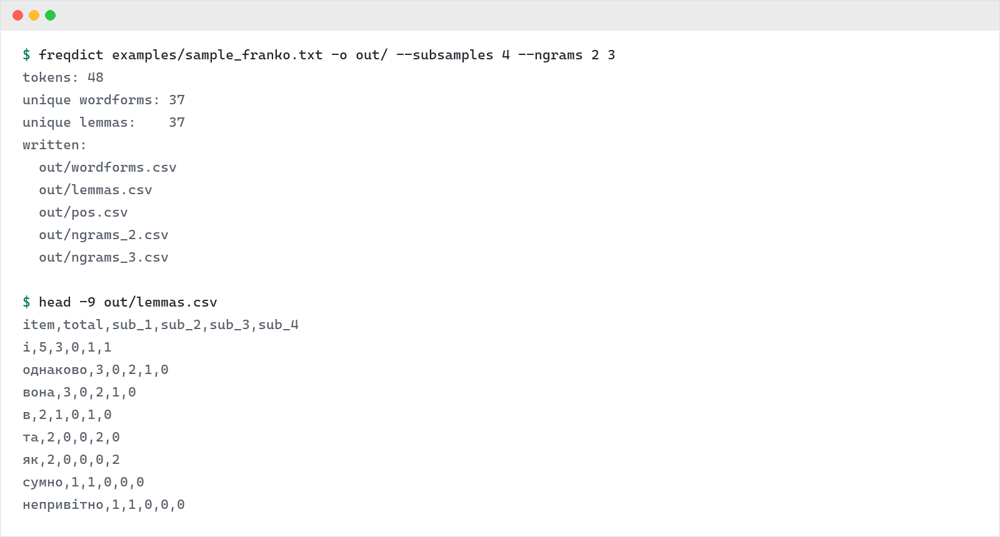

**English** | [Українська](README.uk.md)

[](https://github.com/ZavarOvek/ua-freq-dict/actions/workflows/ci.yml)
[](https://www.python.org/downloads/)
[](LICENSE)
[](https://github.com/astral-sh/ruff)

# freqdict — Frequency Dictionaries for Ukrainian Text

A command-line tool and Python library that builds a complete frequency
dictionary from raw Ukrainian text: **wordforms, lemmas, part-of-speech
distribution and n-grams**, with per-subsample frequency breakdowns ready for
statistical analysis (variance, chi-squared, t-tests).

Built as a production rewrite of my applied-linguistics coursework at Taras
Shevchenko National University of Kyiv (corpus of 20,000 tokens, 20 subsamples,
methodology after V. Perebyinis).

## Features

- Robust Ukrainian tokenization: apostrophe normalization (`м’ята` = `м'ята`),
  in-word hyphens (`будь-хто`), Latin/digits filtered out
- Lemmatization and POS tagging via `pymorphy3` with caching for speed
- Three frequency tables (wordforms, lemmas, POS) with configurable subsample
  columns — the standard input format for quantitative-linguistics statistics
- Token-level n-grams (any sizes, default bigrams + trigrams)
- Export to CSV (UTF-8 BOM, Excel-friendly), multi-sheet XLSX and SQLite
- Fully tested (pytest), no notebook dependencies, installable CLI

## Install

```bash
pip install .
```

## Usage

```bash
freqdict input.txt -o out/ --limit 20000 --subsamples 20 --ngrams 2 3 --xlsx --sqlite
```

Output:

```
tokens: 20000
unique wordforms: 6841
unique lemmas:    4127
written:
  out/wordforms.csv
  out/lemmas.csv
  out/pos.csv
  out/ngrams_2.csv
  out/ngrams_3.csv
  out/freq_dict.xlsx
  out/freq_dict.db
```



Sample of `lemmas.csv` (Ivan Franko, *Zakhar Berkut*, public domain):

| item     | total | sub_1 | sub_2 | sub_3 | sub_4 |
|----------|-------|-------|-------|-------|-------|
| і        | 5     | 3     | 0     | 1     | 1     |
| однаково | 3     | 0     | 2     | 1     | 0     |
| вона     | 3     | 0     | 2     | 1     | 0     |

## As a library

```python
from freqdict import tokenize, build_all

tokens = tokenize(open("input.txt", encoding="utf-8").read())
tables = build_all(tokens, n_subsamples=20, ngram_sizes=(2, 3))
tables["lemmas"].head()
```

## Testing

```bash
pip install -e '.[dev]'
pytest
ruff check .
```

## License

MIT
