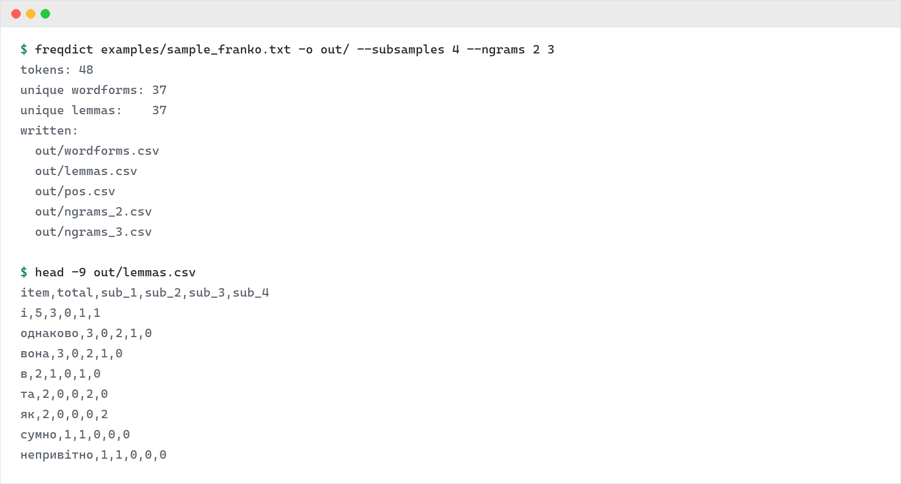

[English](README.md) | **Українська**

# freqdict — Частотні словники для української мови

Інструмент командного рядка та Python-бібліотека для побудови повного
частотного словника з сирого українського тексту: **словоформи, леми,
розподіл частин мови та n-грами**, з розбивкою частот по підвибірках,
готовою для статистичного аналізу (дисперсія, хі-квадрат, t-критерій).

Продакшн-переписування моєї курсової роботи з прикладної лінгвістики в
Київському національному університеті імені Тараса Шевченка (корпус 20 000
токенів, 20 підвибірок, методика за В. Перебийніс).

## Можливості

- Надійна українська токенізація: нормалізація апострофів (`м’ята` = `м'ята`),
  внутрішньослівні дефіси (`будь-хто`), латиниця й цифри відфільтровуються
- Лематизація та розмітка частин мови через `pymorphy3` з кешуванням
- Три частотні таблиці (словоформи, леми, частини мови) з налаштовуваними
  колонками підвибірок — стандартний формат вхідних даних для статистики
  в квантитативній лінгвістиці
- N-грами на рівні токенів (будь-якого розміру, за замовчуванням біграми й
  триграми)
- Експорт у CSV (UTF-8 BOM, сумісний з Excel), багатоаркушевий XLSX та SQLite
- Повністю покрито тестами (pytest), без залежності від ноутбуків,
  встановлюваний CLI

## Встановлення

```bash
pip install .
```

## Використання

```bash
freqdict input.txt -o out/ --limit 20000 --subsamples 20 --ngrams 2 3 --xlsx --sqlite
```

Вивід:

```
tokens: 20000
unique wordforms: 6841
unique lemmas:    4127
written:
  out/wordforms.csv
  out/lemmas.csv
  out/pos.csv
  out/ngrams_2.csv
  out/ngrams_3.csv
  out/freq_dict.xlsx
  out/freq_dict.db
```



Фрагмент `lemmas.csv` (Іван Франко, *«Захар Беркут»*, суспільне надбання):

| item     | total | sub_1 | sub_2 | sub_3 | sub_4 |
|----------|-------|-------|-------|-------|-------|
| і        | 5     | 3     | 0     | 1     | 1     |
| однаково | 3     | 0     | 2     | 1     | 0     |
| вона     | 3     | 0     | 2     | 1     | 0     |

## Як бібліотека

```python
from freqdict import tokenize, build_all

tokens = tokenize(open("input.txt", encoding="utf-8").read())
tables = build_all(tokens, n_subsamples=20, ngram_sizes=(2, 3))
tables["lemmas"].head()
```

## Тестування

```bash
pip install -e .[dev]
pytest
```

## Ліцензія

MIT
